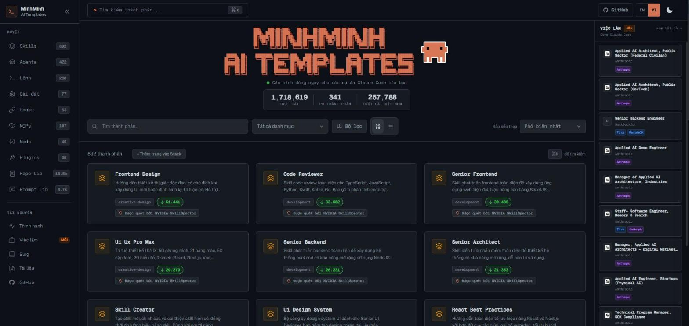
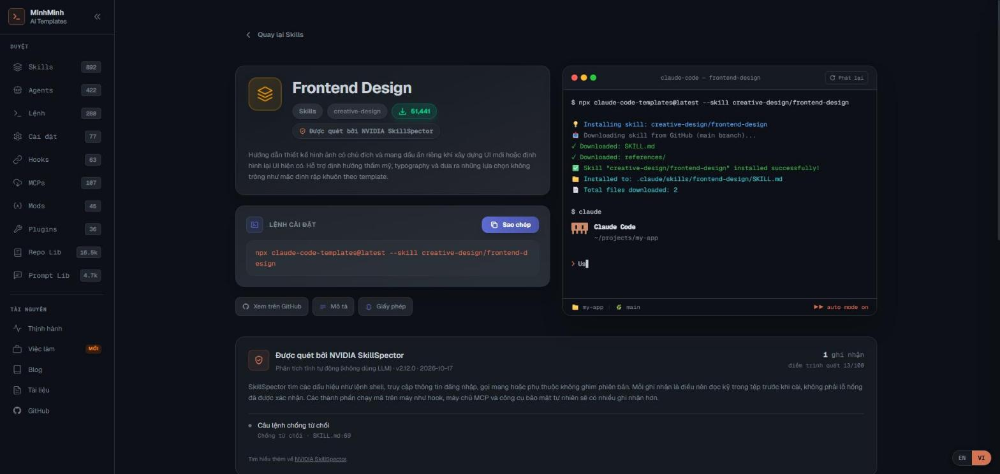
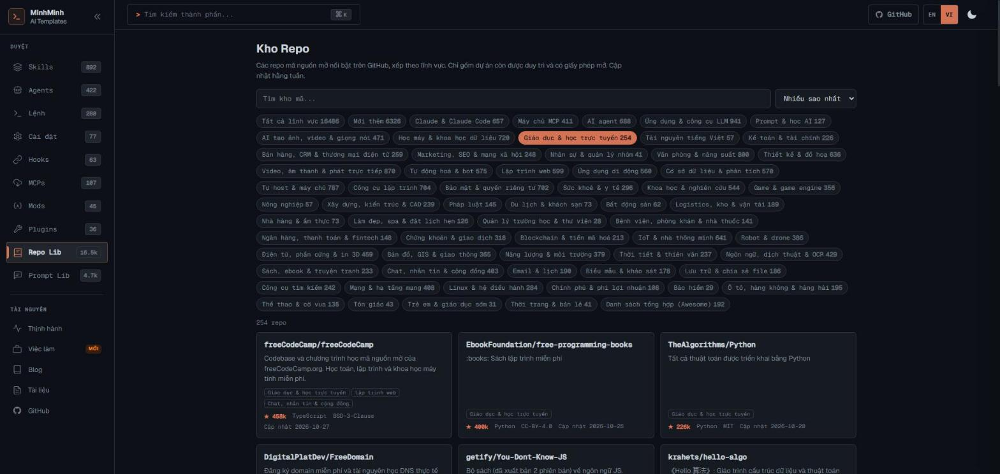
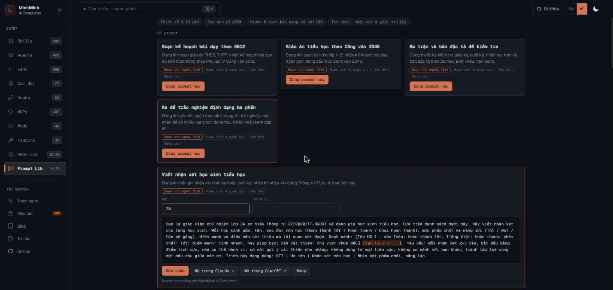

# MinhMinh AI Templates — minhminh.edu.vn

**Tiếng Việt** · [English](README.en.md)

Kho tài nguyên AI miễn phí bằng tiếng Việt: mẫu dùng sẵn cho Claude Code, hơn 16.000 dự án mã nguồn mở trên GitHub theo 62 lĩnh vực, và gần 4.700 prompt dùng ngay cho Claude và ChatGPT, trong đó gần 1.500 prompt soạn riêng cho người Việt.

🌐 **https://minhminh.edu.vn**

---

## Có gì trên minhminh.edu.vn

### 1. Mẫu Claude Code bằng tiếng Việt
Gần 2.000 thành phần dùng sẵn cho [Claude Code](https://claude.com/claude-code): skill, agent, lệnh tắt, hook, MCP, cài đặt, mod, plugin. Mô tả và toàn bộ nội dung hướng dẫn (1.675 trang) đã dịch sang tiếng Việt. Mỗi mẫu cài bằng một dòng lệnh.

### 2. Kho Repo — https://minhminh.edu.vn/repos
- **16.000+ dự án mã nguồn mở** nổi bật trên GitHub, chia **62 lĩnh vực**: AI và Claude, giáo dục, kế toán – tài chính, marketing, nhân sự, văn phòng, thiết kế, video, y tế, pháp luật, bất động sản, làm đẹp – spa, nhà hàng, du lịch, logistics, nông nghiệp, IoT, robot…
- Chỉ lấy dự án **còn được duy trì** (cập nhật trong 1 năm), **có giấy phép mở**, và loại các dự án độc hại hoặc lừa đảo.
- **Mô tả tiếng Việt** cho từng dự án; tìm kiếm, lọc theo lĩnh vực, mục **"Mới thêm"**.
- Không thấy trong kho thì trang **tự tìm tiếp trên toàn bộ GitHub**.

### 3. Kho Prompt — https://minhminh.edu.vn/prompts
- **4.695 prompt** trong **29 lĩnh vực** theo nghề: giáo viên, học sinh – sinh viên, kế toán – thuế, nhân sự, marketing, bán hàng, chủ doanh nghiệp, pháp luật, y tế, bất động sản, spa, nhà hàng, du lịch, lập trình, Excel – dữ liệu, tạo ảnh AI, video – TikTok…
- **1.457 prompt soạn riêng cho bối cảnh Việt Nam**: giáo án theo Công văn 5512/2345, nhận xét học sinh theo Thông tư 27, hoá đơn điện tử, định khoản theo Thông tư 200/133, tính lương Gross ra Net, bán hàng Zalo/TikTok Shop…
- **3.238 prompt nguồn mở** chọn lọc, đã dịch và chỉnh cho người Việt.
- **Điền vào chỗ trống**, rồi **Sao chép** hoặc **mở thẳng trong Claude / ChatGPT**.

### 4. Tự cập nhật
| Việc | Khi nào |
|---|---|
| Đồng bộ mẫu Claude Code từ dự án gốc, dịch mô tả mới | Mỗi đêm, 03:30 |
| Gom và dịch dự án mới cho Kho Repo, gửi báo cáo qua Telegram | Thứ Hai, 02:00 |
| Gom và dịch prompt mới cho Kho Prompt | Thứ Hai, 03:00 |

Web có giao diện **tiếng Việt / tiếng Anh** (nút EN | VI), chạy tốt trên điện thoại, không cần đăng ký, và đếm lượt xem bằng Cloudflare Web Analytics, **không dùng cookie theo dõi**.

---

## Công nghệ

| Phần | Dùng |
|---|---|
| Giao diện | Astro 5, React, Tailwind CSS |
| Chạy web | Cloudflare Pages (gói miễn phí), Cloudflare Web Analytics |
| Tự động hoá | GitHub Actions: đồng bộ, dịch, dựng và đưa lên web |
| Dịch và biên soạn | Claude (Anthropic API): Opus cho nội dung quan trọng, Sonnet cho số lượng lớn; Claude Code chạy trên mây cho nội dung dài |
| Lớp tiếng Việt | Bộ dịch chạy trên trình duyệt + nội dung dịch sẵn phía máy chủ, không sửa mã của dự án gốc |

---

## Ghi công và giấy phép

minhminh.edu.vn được xây dựa trên các dự án mở sau. Xin cảm ơn các tác giả:

- **[Claude Code Templates](https://github.com/davila7/claude-code-templates)** (aitmpl.com) — © Daniel Ávila và cộng sự, giấy phép **MIT**. Danh mục mẫu Claude Code và giao diện gốc.
- **[prompts.chat](https://github.com/f/prompts.chat)** (Awesome ChatGPT Prompts) — **CC0 1.0**.
- **[Fabric](https://github.com/danielmiessler/Fabric)** — Daniel Miessler, **MIT**.
- **[Microsoft Prompts for Edu](https://github.com/microsoft/prompts-for-edu)** — **MIT**.
- **[Awesome NotebookLM Prompts](https://github.com/serenakeyitan/awesome-notebookLM-prompts)** — **MIT**.
- **[Awesome Nano Banana Pro](https://github.com/ZeroLu/awesome-nanobanana-pro)** và **[Awesome Seedance](https://github.com/ZeroLu/awesome-seedance)** — ZeroLu, **MIT**.
- **[GPT-Image-2 API Prompts](https://github.com/Evolink-AI/awesome-gpt-image-2-API-Prompts)** — Evolink AI, **CC0 1.0**.
- **[Nano Banana Pro Prompts](https://github.com/YouMind-OpenLab/awesome-nano-banana-pro-prompts)** và **[GPT Image 2 Prompts](https://github.com/YouMind-OpenLab/awesome-gpt-image-2)** — YouMind OpenLab, **CC BY 4.0**.
- Danh sách dự án trong Kho Repo lấy từ GitHub; mỗi dự án thuộc về tác giả của nó và theo giấy phép riêng của dự án đó.

Phần tiếng Việt trên web được dịch máy bằng Claude và có thể còn sai sót. Góp ý xin gửi về **admin@minhminh.edu.vn**.

---

⭐ **Thấy hữu ích?** Bấm **Star** ở góc trên repo này để nhiều người biết đến minhminh.edu.vn hơn. Cảm ơn anh chị!

---

## Liên hệ

- Web: https://minhminh.edu.vn
- Email: admin@minhminh.edu.vn
- GitHub: [@haohaoit](https://github.com/haohaoit)

Nội dung README này và ảnh chụp màn hình được chia sẻ theo giấy phép [CC BY 4.0](https://creativecommons.org/licenses/by/4.0/).
